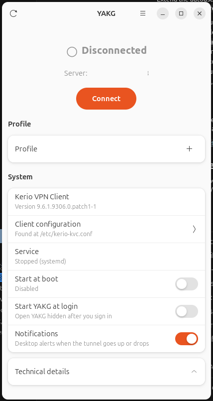

<p align="center">
  
</p>

# YAKG — Yet Another Kerio GUI

A small, native GNOME desktop frontend for the **Kerio Control VPN Client** on Linux.

> **YAKG is an independent open-source project and is not affiliated with, endorsed by, or
> maintained by GFI Software or Kerio Technologies.**

The Kerio Control VPN Client for Linux is managed entirely from the command line: you
reconfigure it with `dpkg-reconfigure`, start it with `systemctl`, and find out what it is doing
by reading log files. YAKG puts a small window in front of that.

YAKG is **not** a VPN implementation. It does not speak the Kerio protocol and contains no
Kerio code. It drives the client you already have installed.

## Status

Early development. **Milestones 1–6 are complete**: YAKG can detect the client, control the
service, connect and disconnect, report whether the tunnel is actually up, keep named
profiles, and stay in the background with a tray icon and desktop notifications.

| Milestone | Scope | State |
| --- | --- | --- |
| 1 | Detection and status | Done |
| 2 | Service control (start, stop, restart, enable, disable) | Done |
| 3 | Connection control and real connection state | Done |
| 4 | Configuration viewing, validation and safe saving | Done |
| 5 | Profiles | Done |
| 6 | Tray, notifications, autostart | Done |

## Screenshots



## Supported versions

| | Verified | Notes |
| --- | --- | --- |
| Ubuntu | 24.04 LTS | Should work on any release with GTK 4 and libadwaita 1.2+. |
| Desktop | GNOME (Wayland and X11) | Any GTK 4 environment should work. |
| Kerio Control VPN Client | 9.6.1.9306.0 | Other 9.x versions are likely fine; see below. |
| Python | 3.10+ | Developed against 3.12. |

YAKG's knowledge of the Kerio client is recorded in [docs/kerio-facts.md](docs/kerio-facts.md),
with the evidence behind each fact. If you run a different Kerio version, YAKG will still detect
it, and that document is where to record anything that turns out to differ.

Both systemd and SysV init are supported, because the Kerio package ships a unit *and* an init
script. YAKG picks whichever is actually in charge at runtime, so it also works inside containers
and WSL images that do not boot with systemd.

## Installation

Download the `.deb` from the [latest GitHub Release](https://github.com/alirezaazadbakht/yakg/releases/latest) and install it:

```bash
sudo apt install ./yakg_*_all.deb
yakg
```

That puts `yakg` on your PATH and *YAKG* in the applications list. The package includes
`/usr/libexec/yakg-helper` and the polkit action that lets it read and write
`/etc/kerio-kvc.conf`. **Applying a profile (Connect, or switching while connected)
needs the helper.** Disconnect does not.

If you previously installed with `pip install --user`, remove that copy so it does not
shadow `/usr/bin/yakg`:

```bash
pip uninstall yakg
```

### Install from source

The GTK bindings deliberately come from apt rather than pip: PyGObject built from PyPI has to
match the system GTK, and installing it from the distribution avoids that whole problem.

```bash
sudo apt install python3-pip python3-gi python3-gi-cairo gir1.2-gtk-4.0 gir1.2-adw-1 gir1.2-secret-1
git clone https://github.com/alirezaazadbakht/yakg.git
cd yakg
pip install --user .
sudo ./packaging/install-helper.sh
yakg
```

`install-helper.sh` is only needed for this source path. It installs
`/usr/libexec/yakg-helper` and the polkit action. A `.deb` install already includes both.

## Usage

Launch `yakg`, or find *YAKG* in your applications list.

The primary button is **Connect**, **Cancel**, or **Disconnect**:

- Connect starts the Kerio service. The window shows *Connecting…* and the button becomes
  Cancel until the Kerio log reports a live tunnel, or you cancel (which stops the service).
  If the tunnel is not up after about 45 seconds, YAKG says so and leaves the service running
  so the client can keep retrying.
- Disconnect (and Cancel) stop the service. There is no separate Kerio connect command.
- Closing the window **hides** YAKG; **Quit** in the header menu or the tray exits.
  While hidden, YAKG still watches the tunnel so a drop can show a desktop
  notification. A second `yakg`, a tray click, or a notification click shows the
  window again.
- *Start at boot* starts the Kerio service when the computer boots. *Start YAKG
  at login* is separate: it launches `yakg --hidden` after you sign in, and does
  not Connect. *Notifications* controls those desktop alerts (not the in-window
  toasts).
- A tray icon (StatusNotifierItem) follows the connection state. Ubuntu 24.04
  usually draws it through the AppIndicator extension
  (`gnome-shell-extension-appindicator`). Without a StatusNotifier host the icon
  is omitted; hide-on-close and notifications still work.
- Restart is in the header menu.
- The **Profile** picker chooses which named connection Connect will use. Connect writes
  that profile into the Kerio client (if it is not already the active one) and then starts
  the service. Switching the picker while connected writes the new profile and reloads.
- **Settings** (header menu, Ctrl+comma, the configuration row, or Add on the picker)
  edits the selected profile: name, server, port, username, password and fingerprint.
  The password is stored in the desktop secret store, not in the profile file. Leave the
  field blank to keep the saved password. Save does not write `/etc` unless you are
  editing the profile that is already applied and the service is running.

Each privileged action asks for administrator authentication through the normal GNOME
password dialog; dismissing the dialog cancels the action and is not treated as an error.

YAKG re-checks every few seconds while it is running, including when the window
is hidden. Press the refresh button, or Ctrl+R, to re-check immediately.

For troubleshooting, or on a machine with no desktop, the same information is available as text:

```console
$ yakg --detect
YAKG 0.1.0 detection report

Kerio Control VPN Client
  Installed:      yes
  Version:        9.6.1.9306.0.patch1-1
  Executable:     /usr/sbin/kvpncsvc
  Detected via:   dpkg and executable
  Configuration:  /etc/kerio-kvc.conf
  Logs:           /var/log/kerio-kvc

Service
  Found:          yes
  Init system:    systemd
  Unit:           kerio-kvc.service
  Running:        Stopped
  Start at boot:  Disabled

Profile
  Active:         none

Connection
  State:          Disconnected
  Server:         not seen
  Tunnel address: not seen
```

`yakg --debug` turns on debug logging. `yakg --hidden` starts without showing the
window (this is what login autostart uses). Logs are written to
`~/.local/state/yakg/yakg.log`.

## Profile management

The Kerio client holds exactly one connection. YAKG keeps any number of named profiles
under `~/.config/yakg/profiles/` and writes exactly one of them into `/etc/kerio-kvc.conf`
when you Connect, or when you switch the picker while already connected.

Non-secret fields (name, server, port, username, fingerprint) live in those JSON files.
The password lives in the desktop secret store (GNOME Keyring via libsecret), never in
the profile file. The helper still writes the password to Kerio only as the vendor
`XOR:` blob, and only at activate time. A write still copies the live file to
`/var/backups/yakg/` first and restores it if verification fails.

## Security model

Three things drive YAKG's design here.

**The GUI does not run as root.** There is no `sudo yakg`. The interface runs as your user.

Starting or stopping the service is a plain `systemctl` call; systemd asks polkit, and the
session agent prompts. The actions involved are the ones systemd already ships:

- `org.freedesktop.systemd1.manage-units` for start, stop, restart and reload
- `org.freedesktop.systemd1.manage-unit-files` for enable and disable

On a host that is not running systemd, YAKG falls back to `pkexec` on the Kerio init script
and on `update-rc.d`. That path has not been verified on a live SysV system.

Reading and writing `/etc/kerio-kvc.conf` is a different privilege. There is no existing
polkit action for that file, so YAKG ships one helper and one action:

- `yakg-helper` at `/usr/libexec/yakg-helper`, verbs `read`, `write` and `restore` only
- `io.github.yakg.Yakg.manage-config` (`auth_admin_keep` for an active session)

The helper is the only process that opens the file. Configuration text and any new password
travel on stdin, never in argv. A write validates, copies the existing file to
`/var/backups/yakg/`, replaces it atomically, and restores the backup if verification fails.

**Commands are never built as shell strings.** Every external command goes through one runner
that takes an argument vector and never invokes a shell, so no value YAKG handles can be
interpreted as shell syntax. Secrets are passed on standard input rather than in arguments,
because arguments are visible to every user on the machine through `/proc`.

**Logs are scrubbed.** Every log handler carries a redaction filter that removes passwords,
private keys and Kerio's obfuscated password form before anything reaches the disk.

### About the Kerio password

You should know how the Kerio client stores your password, because it affects what YAKG can
promise you.

`/etc/kerio-kvc.conf` contains your VPN password in a form like `XOR:1d1a0b`. That is not
encryption. Each byte is XORed with the constant 85 and hex-encoded, a keyless and symmetric
transform, so anyone able to read the file can trivially recover the password. The file's `0600`
root ownership is the only thing actually protecting it.

YAKG does not change this — it is how the Kerio client works, and YAKG must write a
configuration the client can read. YAKG profile files are not a credential store: they
never contain `password`, `password_xor`, or an `XOR:` blob. The password lives in the
session keyring and is written to Kerio only as that XOR form when a profile is applied.
The Settings password field is write-only: leave it blank to keep the keyring entry, and
YAKG will not decode a stored value just to show it.

YAKG never reads `/etc/kerio-kvc.conf` during detection. Presence is established with a
stat. The helper is what opens it: on first-run import (to seed a profile from an
existing install), when Connect or a live picker switch applies a profile, and when you
save the profile that is already applied while the service is running.

## Development

```bash
sudo apt install python3-venv python3-gi gir1.2-gtk-4.0 gir1.2-adw-1 gir1.2-secret-1
git clone https://github.com/alirezaazadbakht/yakg.git
cd yakg
python3 -m venv --system-site-packages .venv   # for the system GTK bindings
source .venv/bin/activate
pip install -e ".[dev]"

pytest        # tests
ruff check .  # lint
ruff format . # format
mypy          # types
```

The test suite needs no root, no VPN connection and no desktop session. Every system
interaction is faked, so the tests never touch the machine they run on, including
`/etc/kerio-kvc.conf`. CI deliberately runs without GTK installed, which enforces the rule
that the backend stays importable without a desktop stack.

### Architecture

```text
src/yakg/
├── main.py            entry point, --detect, --hidden and --version
├── app.py             GTK application, actions, accelerators, hold
├── helper.py          privileged entry (read/write/restore); no GTK
├── resources/         application icon (hicolor)
├── ui/                widgets and the SNI tray; never runs a system command
├── backend/
│   ├── process.py     the only place a subprocess is spawned
│   ├── constants.py   verified Kerio paths and names
│   ├── detect.py      is the client installed?
│   ├── classify.py    maps systemctl/pkexec errors to ActionOutcome
│   ├── connection.py  parses VpnFSM status from debug.log
│   ├── config.py      parse, validate, XOR, atomic write
│   ├── config_access.py  pkexec the helper; XML on stdin
│   ├── fingerprint.py openssl s_client / x509, argv only
│   ├── paths.py       XDG config home for YAKG's own files
│   ├── profiles.py    named profiles on disk; never a password
│   ├── secrets.py     libsecret / in-memory secret store
│   ├── activate.py    project a profile through the helper
│   ├── preferences.py start-at-login and notification toggles
│   ├── autostart.py   XDG autostart desktop file
│   ├── notify.py      when to send a desktop notification
│   ├── tray_spec.py   tray icons and menu labels; no D-Bus
│   ├── service.py     systemd and SysV backends
│   └── status.py      assembles one snapshot for the UI
├── models/            frozen dataclasses shared by both sides
└── utils/             logging and redaction
```

The backend has no GTK dependency and is usable on its own, which is what makes `--detect` and
the test suite possible. The interface never runs a system command; it calls the backend and
updates itself when the answer arrives.

Detection runs on a worker thread and returns to the main loop through `GLib.idle_add`, so a slow
`systemctl` call cannot freeze the window.

Two conventions are worth knowing before contributing. State that cannot be determined is
reported as unknown rather than guessed: `active` and `enabled_at_boot` are tri-state, and a
timed-out probe produces "Unknown", never "Stopped". And facts about Kerio get verified and
written down in [docs/kerio-facts.md](docs/kerio-facts.md) before code depends on them.

## Troubleshooting

**"Kerio VPN Client not found"** — YAKG looks for the `kerio-control-vpnclient` package and for
a `kvpncsvc` executable in `/usr/sbin`, `/usr/local/sbin` and `/sbin`. Run `yakg --detect` to see
what it found. A package that was removed but not purged is correctly reported as not installed.

**The service shows "Unknown"** — YAKG could not determine the state, which is different from
knowing it is stopped. Open *Technical details* for the raw command output. The usual cause is
systemd being installed but not running as PID 1, which happens in containers and WSL. The
Connect button is disabled in that case; Restart remains available.

**Nothing happens after I close the password dialog** — that is intentional. Dismissing the
authentication prompt cancels the action and is not treated as an error.

**"YAKG could not ask for administrator authentication"** — no polkit agent is available in
this session. On GNOME the agent is provided by gnome-shell; a headless or remote session will
not have one.

**"Could not connect to the VPN"** — the service started but the Kerio log did not report a
live tunnel within about 45 seconds. The service is left running so the client can keep
retrying. Open *Technical details* for the last VpnFSM line. Cancel stops the service.

**Connection stays on Connecting…** — the daemon retries every 30 seconds after an error.
That is still Connecting, not Disconnected. The last error, when known, is shown under the
status.

**Settings or Connect says the helper is needed** — a `.deb` install already includes the
helper. For a source install, run `sudo ./packaging/install-helper.sh` from the source
tree. Disconnect works without it. Applying a profile needs the helper.

**There is no tray icon** — GNOME needs a StatusNotifier host. On Ubuntu, install and
enable `gnome-shell-extension-appindicator`, then sign out and back in. Closing the
window still hides YAKG, and notifications still work.

**The window will not start** — run `yakg` from a terminal. Missing GTK bindings produce an
explanation and the apt command that fixes it.

## Known limitations

- Tunnel state comes from the Kerio `debug.log` VpnFSM lines, not from a network interface.
  The interface name when connected is still unknown.
- A 45-second connect timeout does not stop the service; the client keeps retrying.
- The SysV control path (`pkexec` on the init script and `update-rc.d`) is unverified on a
  live SysV host.
- The tray icon needs a StatusNotifier host (on GNOME, the AppIndicator
  extension). Vanilla GNOME without that extension has no icon.
- Verified against exactly one Kerio version, on Ubuntu 24.04.

## Contributing

Issues and pull requests are welcome. A few expectations:

- Do not guess at Kerio behaviour. Verify it against an installation or reliable documentation,
  and record it in [docs/kerio-facts.md](docs/kerio-facts.md). An honest "unresolved" is much
  better than an invented detail.
- Keep system interaction out of the UI, and keep the backend importable without GTK.
- Add a test with a bug fix when it is practical.
- Run `pytest`, `ruff check .` and `mypy` before opening a pull request.
- Never commit credentials, real configuration files, or anything belonging to Kerio or GFI.

## License

MIT. See [LICENSE](LICENSE).

YAKG contains no Kerio or GFI code, binaries, logos or other assets. "Kerio" and "Kerio Control"
are trademarks of their respective owners and are used here only to describe what this program
interoperates with.
